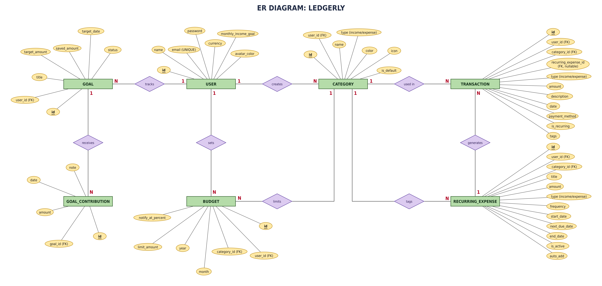
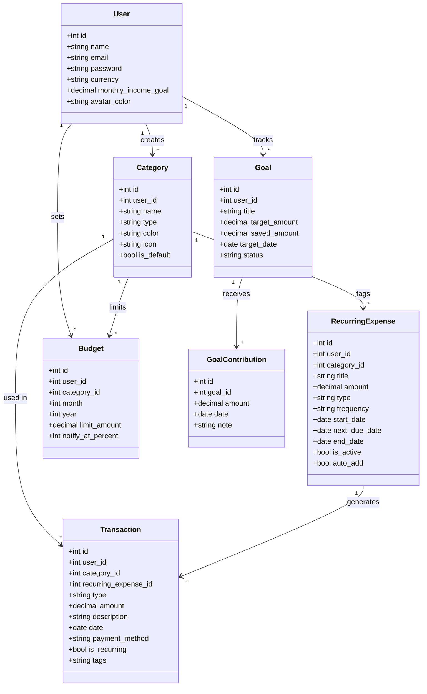
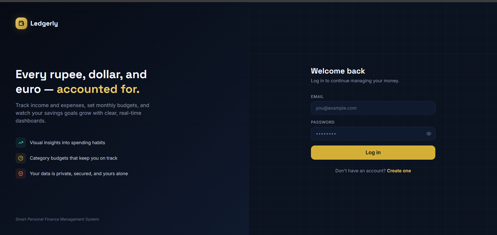
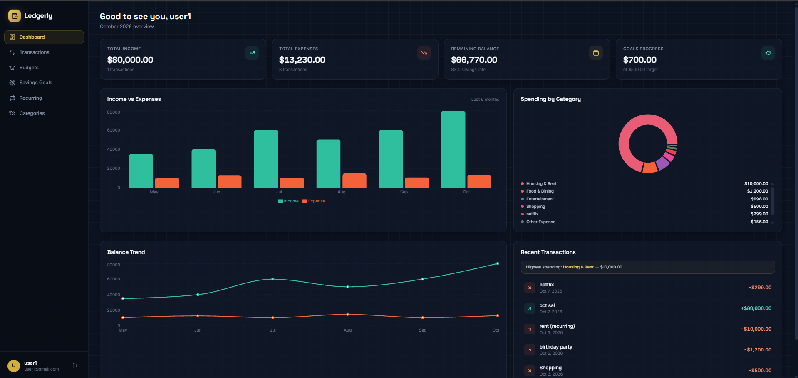
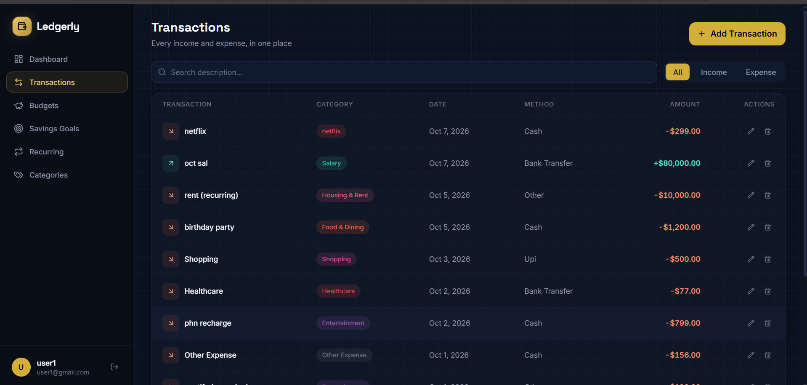
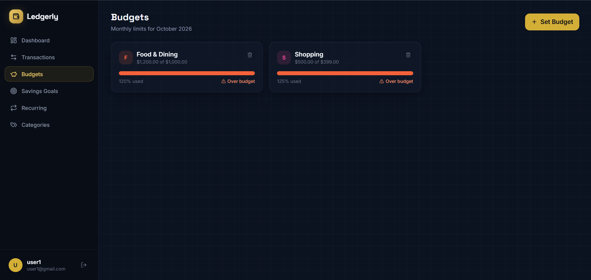
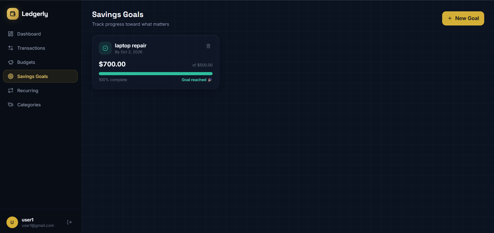

# Ledgerly – Personal Finance Management System

> A DBMS project to track income and expenses, set budgets, automate recurring payments, and reach savings goals.

---

## 1. Project Title and Team Details

**Project Title:** Ledgerly – Personal Finance Management System

| Name | Roll No. / Reg. No. | Role |
|---|---|---|
| [Member 1 name] | [Roll no.] | [e.g. Database design] |
| [Member 2 name] | [Roll no.] | [e.g. Backend] |
| [Member 3 name] | [Roll no.] | [e.g. Frontend] |

**Course:** [Course name and code]
**Institution:** [College / University name]
**Guide / Faculty:** [Faculty name]

---

## 2. Project Overview, Introduction and Problem Statement

### Introduction
Managing personal money is difficult when income, expenses, bills and savings are tracked in notebooks or scattered apps. **Ledgerly** is a database-driven application that keeps all of a user's financial data in one structured, consistent place.

### Problem Statement
Most people do not know where their money goes each month. They forget recurring payments, overspend in some categories, and have no clear view of progress towards savings goals. Existing spreadsheets are error-prone and do not enforce data consistency.

### Objectives
- Record income and expense transactions with category, date and payment method.
- Let users set monthly budgets per category and get alerts near the limit.
- Schedule recurring expenses (rent, subscriptions) and generate transactions automatically.
- Track savings goals through contributions and show progress.
- Keep the data consistent with a normalised relational schema and proper constraints.

### Key Features
| Module | What it does |
|---|---|
| User management | Profile with currency, monthly income goal and avatar colour |
| Categories | Default and custom categories with colour and icon |
| Transactions | Income and expense records with tags and payment method |
| Budgets | Monthly limit per category with `notify_at_percent` alert |
| Recurring expenses | Scheduled payments with frequency, start/end date and auto-add |
| Goals | Savings targets with contributions and status |

---

## 3. System Requirements and Architecture

### Software Requirements
| Component | Requirement |
|---|---|
| Database | MySQL 8.0+ *(replace if you use PostgreSQL/SQLite)* |
| Backend | Python 3.10+ with Flask *(replace with your stack)* |
| Frontend | HTML, CSS, JavaScript *(or React, etc.)* |
| Tools | Git, MySQL Workbench / CLI, a web browser |

### Hardware Requirements
- Any computer with 4 GB RAM or more and 1 GB free disk space.

### Architecture (3-tier)

```
┌──────────────┐     HTTP/JSON     ┌──────────────────┐     SQL (parameterized)     ┌──────────────┐
│   Frontend   │ ────────────────► │  Backend (API)   │ ──────────────────────────► │   Database   │
│ HTML/CSS/JS  │ ◄──────────────── │  Flask / Node.js │ ◄────────────────────────── │    MySQL     │
└──────────────┘                   └──────────────────┘      connection pooling     └──────────────┘
```

- **Presentation layer:** the UI where users enter and view data.
- **Application layer:** validates input, applies business rules, and talks to the database.
- **Data layer:** stores everything in a normalised relational schema.

---

## 4. ER Diagram and UML Diagram

### ER Diagram


**Entities:** USER, CATEGORY, TRANSACTION, RECURRING_EXPENSE, BUDGET, GOAL, GOAL_CONTRIBUTION

**Relationships:**

| Relationship | Entities | Cardinality |
|---|---|---|
| creates | USER – CATEGORY | 1 : N |
| tracks | USER – GOAL | 1 : N |
| sets | USER – BUDGET | 1 : N |
| used in | CATEGORY – TRANSACTION | 1 : N |
| limits | CATEGORY – BUDGET | 1 : N |
| tags | CATEGORY – RECURRING_EXPENSE | 1 : N |
| generates | RECURRING_EXPENSE – TRANSACTION | 1 : N |
| receives | GOAL – GOAL_CONTRIBUTION | 1 : N |

### UML Class Diagram
*(GitHub renders this automatically. You can also replace it with an image.)*



---

## 5. Relational Schema Mapping

Primary keys are <u>underlined</u>, foreign keys are marked **(FK)**.

```
USERS (id, name, email [UNIQUE], password, currency, monthly_income_goal, avatar_color)

CATEGORIES (id, user_id (FK → USERS), name, type, color, icon, is_default)

RECURRING_EXPENSES (id, user_id (FK → USERS), category_id (FK → CATEGORIES), title, amount,
                    type, frequency, start_date, next_due_date, end_date, is_active, auto_add)

TRANSACTIONS (id, user_id (FK → USERS), category_id (FK → CATEGORIES),
              recurring_expense_id (FK → RECURRING_EXPENSES, nullable),
              type, amount, description, date, payment_method, is_recurring, tags)

BUDGETS (id, user_id (FK → USERS), category_id (FK → CATEGORIES),
         month, year, limit_amount, notify_at_percent)

GOALS (id, user_id (FK → USERS), title, target_amount, saved_amount, target_date, status)

GOAL_CONTRIBUTIONS (id, goal_id (FK → GOALS), amount, date, note)
```

**Mapping rules used**
- Each entity becomes a table; its `id` attribute becomes the primary key.
- Every 1 : N relationship is mapped by placing the primary key of the "1" side as a foreign key in the "N" side.
- The relationship *generates* is optional, so `recurring_expense_id` in TRANSACTIONS is nullable.

> **Note:** `user` and `transaction` are reserved words in several databases, so the tables are named `users` and `transactions` in the SQL scripts.

---

## 6. Normalization and Functional Dependencies

### Functional dependencies
| Table | Functional dependencies |
|---|---|
| USERS | `id → name, email, password, currency, monthly_income_goal, avatar_color`; `email → id` |
| CATEGORIES | `id → user_id, name, type, color, icon, is_default` |
| GOALS | `id → user_id, title, target_amount, saved_amount, target_date, status` |
| GOAL_CONTRIBUTIONS | `id → goal_id, amount, date, note` |
| BUDGETS | `id → user_id, category_id, month, year, limit_amount, notify_at_percent`; `category_id → user_id` |
| TRANSACTIONS | `id → all other columns`; `category_id → type, user_id` (deliberate copies) |
| RECURRING_EXPENSES | `id → all other columns`; `category_id → type, user_id` (deliberate copies) |

### Normal forms in brief
| Form | Rule | Removes |
|---|---|---|
| **1NF** | Every cell holds a single value and every row is unique | Repeating groups |
| **2NF** | 1NF + every column depends on the whole key | Partial dependency |
| **3NF** | 2NF + every column depends only on the key | Transitive dependency |
| **BCNF** | 3NF + every determinant is a key | Remaining redundancy |

### Normalization result
| Form | Result |
|---|---|
| 1NF | Satisfied. Every table has a primary key and atomic values (`tags` is stored as one text field) |
| 2NF | Satisfied. Every table has a single-column primary key (`id`), so partial dependencies are not possible |
| 3NF | Satisfied for most tables, with the deliberate exceptions listed below |
| BCNF | USERS, CATEGORIES, GOALS and GOAL_CONTRIBUTIONS are in BCNF. BUDGETS is not, because `category_id → user_id` |

| Table | Result |
|---|---|
| USERS | BCNF |
| CATEGORIES | BCNF |
| GOAL_CONTRIBUTIONS | BCNF |
| GOALS | BCNF, but `saved_amount` is a stored total |
| BUDGETS | 3NF, not BCNF (`category_id → user_id`) |
| TRANSACTIONS | 3NF, except the deliberate `type` and `user_id` copies |
| RECURRING_EXPENSES | 3NF, except the deliberate `type` and `user_id` copies |

### Deliberate denormalization (and why)
| Column | Where it is copied from | Reason |
|---|---|---|
| `type`, `user_id` in TRANSACTIONS and RECURRING_EXPENSES | CATEGORIES | Avoids a join on the largest, most frequently queried tables |
| `user_id` in BUDGETS | CATEGORIES | Simpler "all budgets of a user" queries |
| `saved_amount` in GOALS | SUM of GOAL_CONTRIBUTIONS | Instant progress display |

**Trade-off:** faster, simpler queries at the cost of a small risk of inconsistent copies. The application validates that these values match the category.

> *The schema is normalised up to 3NF. A few controlled denormalizations are kept on purpose for performance and simplicity.*

---

## 7. Methodology and Database Design

1. **Requirement analysis:** identified the data a personal finance tracker must store.
2. **Conceptual design:** drew the ER diagram with entities, attributes and cardinalities.
3. **Logical design:** mapped the ER diagram to relational tables with keys.
4. **Normalization:** analysed functional dependencies and normalised up to 3NF.
5. **Physical design:** wrote SQL DDL with constraints (PRIMARY KEY, FOREIGN KEY, UNIQUE, CHECK, ON DELETE CASCADE) and indexes.
6. **Implementation:** built the backend with parameterized queries and the frontend UI.
7. **Testing:** validated constraints, queries and application flows.

**Design decisions**
- A single `id` primary key per table keeps joins simple.
- `ON DELETE CASCADE` removes a user's dependent data automatically when the user is deleted.
- `recurring_expense_id` uses `ON DELETE SET NULL`, so old transactions stay when a recurring rule is removed.
- A `UNIQUE (user_id, category_id, month, year)` constraint on BUDGETS prevents duplicate budgets.

---

## 8. Advanced SQL Queries and Their Purpose

All queries are in [`database/queries.sql`](database/queries.sql).

| # | Query | Purpose | Concepts |
|---|---|---|---|
| 1 | Transactions with category name | Show readable transaction history | JOIN |
| 2 | Monthly spending per category | Dashboard summary | JOIN, GROUP BY, SUM |
| 3 | Budget vs actual spending | Detect overspending | LEFT JOIN, GROUP BY, aggregate |
| 4 | Categories over the budget alert level | Trigger budget warnings | JOIN, HAVING |
| 5 | Goal progress percentage | Show progress bars | LEFT JOIN, aggregate, arithmetic |
| 6 | Users who spent above their own average | Find unusual spending | Subquery |
| 7 | Top 3 expense categories per user | Spending insights | Subquery, ORDER BY, LIMIT |
| 8 | Upcoming recurring payments in next 7 days | Reminders | WHERE, date functions |
| 9 | Net balance per user | Income minus expense | CASE, SUM, GROUP BY |
| 10 | Goals not yet started | Spot goals with no contributions | NOT EXISTS (subquery) |

### Sample queries

**Budget vs actual spending**
```sql
SELECT c.name AS category,
       b.limit_amount,
       COALESCE(SUM(t.amount), 0) AS spent,
       ROUND(COALESCE(SUM(t.amount), 0) / b.limit_amount * 100, 1) AS used_percent
FROM budgets b
JOIN categories c ON b.category_id = c.id
LEFT JOIN transactions t
       ON t.category_id = b.category_id
      AND t.type = 'expense'
      AND MONTH(t.date) = b.month
      AND YEAR(t.date) = b.year
WHERE b.user_id = 1 AND b.month = 10 AND b.year = 2026
GROUP BY c.name, b.limit_amount;
```
*Purpose: shows how much of each monthly budget has been used.*

**Categories that crossed the alert level**
```sql
SELECT c.name, b.limit_amount, SUM(t.amount) AS spent, b.notify_at_percent
FROM budgets b
JOIN categories c ON b.category_id = c.id
JOIN transactions t
  ON t.category_id = b.category_id
 AND t.type = 'expense'
 AND MONTH(t.date) = b.month AND YEAR(t.date) = b.year
WHERE b.user_id = 1 AND b.month = 10 AND b.year = 2026
GROUP BY c.name, b.limit_amount, b.notify_at_percent
HAVING SUM(t.amount) >= b.limit_amount * b.notify_at_percent / 100;
```
*Purpose: finds budgets that need a warning notification.*

**Users who spent more than their own average (subquery)**
```sql
SELECT t.id, t.amount, t.date
FROM transactions t
WHERE t.user_id = 1
  AND t.type = 'expense'
  AND t.amount > (SELECT AVG(amount)
                  FROM transactions
                  WHERE user_id = 1 AND type = 'expense');
```
*Purpose: highlights unusually large expenses.*

**Net balance per user**
```sql
SELECT u.name,
       SUM(CASE WHEN t.type = 'income'  THEN t.amount ELSE 0 END) AS total_income,
       SUM(CASE WHEN t.type = 'expense' THEN t.amount ELSE 0 END) AS total_expense,
       SUM(CASE WHEN t.type = 'income'  THEN t.amount ELSE -t.amount END) AS net_balance
FROM users u
LEFT JOIN transactions t ON t.user_id = u.id
GROUP BY u.id, u.name;
```
*Purpose: gives each user's overall financial position.*

**Goals with no contributions (subquery)**
```sql
SELECT g.id, g.title
FROM goals g
WHERE NOT EXISTS (SELECT 1 FROM goal_contributions gc WHERE gc.goal_id = g.id);
```
*Purpose: reminds users about goals they have not started.*

---

## 9. Repository Structure

```
ledgerly/
├── README.md
├── database/
│   ├── schema.sql          # DDL: tables, constraints, indexes
│   ├── sample_data.sql     # Sample data to populate the database
│   └── queries.sql         # Documented advanced queries
├── backend/
│   ├── app.py              # Application entry point
│   ├── db.py               # Database connection pool
│   ├── routes/             # API routes
│   ├── requirements.txt    # Python dependencies
│   └── .env.example        # Example environment variables
├── frontend/
│   ├── index.html
│   ├── css/
│   └── js/
├── tests/
│   ├── test_constraints.sql
│   └── test_api.py
└── screenshots/
    ├── er_diagram.png
    └── ...
```

---

## 10. Database Scripts

### 10.1 Schema (`database/schema.sql`)

```sql
CREATE DATABASE IF NOT EXISTS ledgerly;
USE ledgerly;

-- 1. USERS
CREATE TABLE users (
    id                  INT AUTO_INCREMENT PRIMARY KEY,
    name                VARCHAR(100) NOT NULL,
    email               VARCHAR(150) NOT NULL UNIQUE,
    password            VARCHAR(255) NOT NULL,          -- store a hash, never plain text
    currency            VARCHAR(5)   NOT NULL DEFAULT 'INR',
    monthly_income_goal DECIMAL(12,2) DEFAULT 0 CHECK (monthly_income_goal >= 0),
    avatar_color        VARCHAR(20)
);

-- 2. CATEGORIES
CREATE TABLE categories (
    id         INT AUTO_INCREMENT PRIMARY KEY,
    user_id    INT NOT NULL,
    name       VARCHAR(100) NOT NULL,
    type       VARCHAR(10)  NOT NULL CHECK (type IN ('income', 'expense')),
    color      VARCHAR(20),
    icon       VARCHAR(50),
    is_default BOOLEAN NOT NULL DEFAULT FALSE,
    UNIQUE (user_id, name),
    FOREIGN KEY (user_id) REFERENCES users(id) ON DELETE CASCADE
);

-- 3. RECURRING_EXPENSES
CREATE TABLE recurring_expenses (
    id            INT AUTO_INCREMENT PRIMARY KEY,
    user_id       INT NOT NULL,
    category_id   INT NOT NULL,
    title         VARCHAR(150) NOT NULL,
    amount        DECIMAL(12,2) NOT NULL CHECK (amount > 0),
    type          VARCHAR(10)  NOT NULL CHECK (type IN ('income', 'expense')),
    frequency     VARCHAR(10)  NOT NULL CHECK (frequency IN ('daily', 'weekly', 'monthly', 'yearly')),
    start_date    DATE NOT NULL,
    next_due_date DATE NOT NULL,
    end_date      DATE,
    is_active     BOOLEAN NOT NULL DEFAULT TRUE,
    auto_add      BOOLEAN NOT NULL DEFAULT FALSE,
    CHECK (end_date IS NULL OR end_date >= start_date),
    FOREIGN KEY (user_id)     REFERENCES users(id)      ON DELETE CASCADE,
    FOREIGN KEY (category_id) REFERENCES categories(id) ON DELETE CASCADE
);

-- 4. TRANSACTIONS
CREATE TABLE transactions (
    id                   INT AUTO_INCREMENT PRIMARY KEY,
    user_id              INT NOT NULL,
    category_id          INT NOT NULL,
    recurring_expense_id INT NULL,
    type                 VARCHAR(10)  NOT NULL CHECK (type IN ('income', 'expense')),
    amount               DECIMAL(12,2) NOT NULL CHECK (amount > 0),
    description          VARCHAR(255),
    date                 DATE NOT NULL,
    payment_method       VARCHAR(30),
    is_recurring         BOOLEAN NOT NULL DEFAULT FALSE,
    tags                 VARCHAR(255),
    FOREIGN KEY (user_id)              REFERENCES users(id)              ON DELETE CASCADE,
    FOREIGN KEY (category_id)          REFERENCES categories(id)         ON DELETE CASCADE,
    FOREIGN KEY (recurring_expense_id) REFERENCES recurring_expenses(id) ON DELETE SET NULL
);

-- 5. BUDGETS
CREATE TABLE budgets (
    id                INT AUTO_INCREMENT PRIMARY KEY,
    user_id           INT NOT NULL,
    category_id       INT NOT NULL,
    month             TINYINT NOT NULL CHECK (month BETWEEN 1 AND 12),
    year              SMALLINT NOT NULL CHECK (year >= 2000),
    limit_amount      DECIMAL(12,2) NOT NULL CHECK (limit_amount > 0),
    notify_at_percent TINYINT NOT NULL DEFAULT 80 CHECK (notify_at_percent BETWEEN 1 AND 100),
    UNIQUE (user_id, category_id, month, year),
    FOREIGN KEY (user_id)     REFERENCES users(id)      ON DELETE CASCADE,
    FOREIGN KEY (category_id) REFERENCES categories(id) ON DELETE CASCADE
);

-- 6. GOALS
CREATE TABLE goals (
    id            INT AUTO_INCREMENT PRIMARY KEY,
    user_id       INT NOT NULL,
    title         VARCHAR(150) NOT NULL,
    target_amount DECIMAL(12,2) NOT NULL CHECK (target_amount > 0),
    saved_amount  DECIMAL(12,2) NOT NULL DEFAULT 0 CHECK (saved_amount >= 0),
    target_date   DATE,
    status        VARCHAR(15) NOT NULL DEFAULT 'active'
                  CHECK (status IN ('active', 'completed', 'cancelled')),
    FOREIGN KEY (user_id) REFERENCES users(id) ON DELETE CASCADE
);

-- 7. GOAL_CONTRIBUTIONS
CREATE TABLE goal_contributions (
    id      INT AUTO_INCREMENT PRIMARY KEY,
    goal_id INT NOT NULL,
    amount  DECIMAL(12,2) NOT NULL CHECK (amount > 0),
    date    DATE NOT NULL,
    note    VARCHAR(255),
    FOREIGN KEY (goal_id) REFERENCES goals(id) ON DELETE CASCADE
);

-- Indexes for faster queries
CREATE INDEX idx_txn_user_date ON transactions (user_id, date);
CREATE INDEX idx_txn_category  ON transactions (category_id);
CREATE INDEX idx_budget_user   ON budgets (user_id, year, month);
```

### 10.2 Sample data (`database/sample_data.sql`)

```sql
USE ledgerly;

INSERT INTO users (name, email, password, currency, monthly_income_goal, avatar_color) VALUES
('Ravi Kumar', 'ravi@example.com', 'hashed_password_1', 'INR', 50000, '#4F46E5'),
('Priya S',    'priya@example.com', 'hashed_password_2', 'INR', 60000, '#10B981');

INSERT INTO categories (user_id, name, type, color, icon, is_default) VALUES
(1, 'Salary', 'income',  '#22C55E', 'wallet',  TRUE),
(1, 'Food',   'expense', '#F97316', 'utensils', TRUE),
(1, 'Travel', 'expense', '#3B82F6', 'plane',    TRUE),
(1, 'Rent',   'expense', '#EF4444', 'home',     TRUE);

INSERT INTO recurring_expenses
(user_id, category_id, title, amount, type, frequency, start_date, next_due_date, is_active, auto_add) VALUES
(1, 4, 'House Rent', 12000, 'expense', 'monthly', '2026-01-01', '2026-11-01', TRUE, TRUE);

INSERT INTO transactions
(user_id, category_id, recurring_expense_id, type, amount, description, date, payment_method, is_recurring, tags) VALUES
(1, 1, NULL, 'income',  50000, 'October salary', '2026-10-01', 'bank',   FALSE, 'salary'),
(1, 4, 1,    'expense', 12000, 'October rent',   '2026-10-02', 'upi',    TRUE,  'rent,home'),
(1, 2, NULL, 'expense',   250, 'Lunch',          '2026-10-05', 'upi',    FALSE, 'food'),
(1, 2, NULL, 'expense',   900, 'Dinner outing',  '2026-10-09', 'card',   FALSE, 'food,friends'),
(1, 3, NULL, 'expense',  2500, 'Train tickets',  '2026-10-11', 'upi',    FALSE, 'travel');

INSERT INTO budgets (user_id, category_id, month, year, limit_amount, notify_at_percent) VALUES
(1, 2, 10, 2026, 5000, 80),
(1, 3, 10, 2026, 3000, 90);

INSERT INTO goals (user_id, title, target_amount, saved_amount, target_date, status) VALUES
(1, 'New Laptop', 60000, 15000, '2027-03-31', 'active'),
(1, 'Goa Trip',   20000, 0,     '2027-01-15', 'active');

INSERT INTO goal_contributions (goal_id, amount, date, note) VALUES
(1, 10000, '2026-09-15', 'First instalment'),
(1,  5000, '2026-10-10', 'Bonus money');
```

---

## 11. Backend (`backend/`)

**Technology:** Python (Flask) with `mysql-connector-python` *(replace if you used Node.js or FastAPI)*.

### Secure database connection with pooling (`backend/db.py`)

```python
import os
from mysql.connector import pooling
from dotenv import load_dotenv

load_dotenv()  # credentials come from .env, never hard-coded

pool = pooling.MySQLConnectionPool(
    pool_name="ledgerly_pool",
    pool_size=5,
    host=os.getenv("DB_HOST", "localhost"),
    user=os.getenv("DB_USER"),
    password=os.getenv("DB_PASSWORD"),
    database=os.getenv("DB_NAME", "ledgerly"),
)

def get_connection():
    return pool.get_connection()
```

### Parameterized query (prevents SQL injection)

```python
def get_transactions(user_id):
    conn = get_connection()
    try:
        cur = conn.cursor(dictionary=True)
        cur.execute(
            """SELECT t.id, t.date, t.amount, t.type, c.name AS category
               FROM transactions t
               JOIN categories c ON t.category_id = c.id
               WHERE t.user_id = %s
               ORDER BY t.date DESC""",
            (user_id,),               # values are passed separately, never concatenated
        )
        return cur.fetchall()
    finally:
        conn.close()
```

### Security practices
- Database credentials are stored in a `.env` file (never committed to GitHub).
- All queries use placeholders (`%s`) instead of string concatenation.
- Passwords are stored as hashes (for example with `bcrypt` or `werkzeug.security`).
- A connection pool is reused instead of opening a new connection for every request.

### `.env.example`
```
DB_HOST=localhost
DB_USER=your_mysql_user
DB_PASSWORD=your_mysql_password
DB_NAME=ledgerly
```

### `requirements.txt`
```
flask
mysql-connector-python
python-dotenv
```

---

## 12. Frontend (`frontend/`)

The frontend is built with **HTML, CSS and JavaScript** *(replace with React, etc. if used)* and talks to the backend through JSON API calls.

**Main screens**
- Login / Register
- Dashboard (balance, income vs expense summary)
- Transactions (add, edit, delete, filter)
- Categories
- Budgets (with progress bars)
- Recurring expenses
- Goals and contributions

---

## 13. Installation, Setup and Execution

### Prerequisites
- Git, Python 3.10+, MySQL 8.0+

### Step 1: Clone the repository
```bash
git clone https://github.com/<your-username>/ledgerly.git
cd ledgerly
```

### Step 2: Create and populate the database
```bash
mysql -u root -p < database/schema.sql
mysql -u root -p < database/sample_data.sql
```

Verify:
```sql
USE ledgerly;
SHOW TABLES;
SELECT COUNT(*) FROM transactions;
```
Expected: 7 tables and 5 transactions.

### Step 3: Configure the backend
```bash
cd backend
python -m venv venv
source venv/bin/activate        # Windows: venv\Scripts\activate
pip install -r requirements.txt
cp .env.example .env            # then edit .env with your MySQL username and password
```

### Step 4: Run the application
```bash
python app.py
```
Open **http://localhost:5000** in your browser.

---

## 14. Demonstration Instructions (Reproduce the Project)

1. **Reset the database to a clean state**
   ```bash
   mysql -u root -p -e "DROP DATABASE IF EXISTS ledgerly;"
   mysql -u root -p < database/schema.sql
   mysql -u root -p < database/sample_data.sql
   ```
2. **Start the application:** `python backend/app.py`
3. **Log in** with the sample user `ravi@example.com`.
4. **Show each feature in order:**
   - Add a new transaction and see it in the list and the dashboard.
   - Open Budgets and show the *Food* budget progress (₹1,150 of ₹5,000).
   - Add a goal contribution and see `saved_amount` and the progress bar update.
   - Open Recurring expenses and show the monthly rent.
5. **Run the advanced queries:**
   ```bash
   mysql -u root -p ledgerly < database/queries.sql
   ```
6. **Show constraint behaviour** (see test cases below), for example inserting a negative amount and getting a CHECK error.

---

## 15. Test Cases and Validation Procedures

### Database constraint tests

| ID | Test | Input | Expected result |
|---|---|---|---|
| T1 | UNIQUE email | Insert a second user with `ravi@example.com` | Error: duplicate entry |
| T2 | CHECK amount | Insert a transaction with `amount = -100` | Error: CHECK constraint violated |
| T3 | CHECK type | Insert a category with `type = 'other'` | Error: CHECK constraint violated |
| T4 | FOREIGN KEY | Insert a transaction with `category_id = 999` | Error: foreign key constraint fails |
| T5 | UNIQUE budget | Insert a second budget for the same user, category, month and year | Error: duplicate entry |
| T6 | CHECK month | Insert a budget with `month = 13` | Error: CHECK constraint violated |
| T7 | ON DELETE CASCADE | Delete user 2, then query their categories and goals | No rows remain for that user |
| T8 | ON DELETE SET NULL | Delete a recurring expense | Related transactions remain, with `recurring_expense_id = NULL` |
| T9 | Goal delete cascade | Delete a goal | Its contributions are deleted |

### Application tests

| ID | Test | Expected result |
|---|---|---|
| A1 | Register with an existing email | Error message shown |
| A2 | Add a valid transaction | Appears in the list and updates the dashboard |
| A3 | Add a transaction with an empty amount | Validation error, nothing saved |
| A4 | Spend above `notify_at_percent` of a budget | Warning is displayed |
| A5 | Enter `' OR 1=1 --` in a text field | Treated as plain text, no data leaked (SQL injection prevented) |
| A6 | Add a goal contribution | `saved_amount` and progress update correctly |

### Example constraint tests (`tests/test_constraints.sql`)
```sql
-- T2: should FAIL
INSERT INTO transactions (user_id, category_id, type, amount, date)
VALUES (1, 2, 'expense', -100, '2026-10-14');

-- T4: should FAIL
INSERT INTO transactions (user_id, category_id, type, amount, date)
VALUES (1, 999, 'expense', 100, '2026-10-14');

-- T7: should leave no rows after deleting the user
DELETE FROM users WHERE id = 2;
SELECT COUNT(*) FROM categories WHERE user_id = 2;   -- expected 0
```

---

## 16. Screenshots and Sample Outputs

> Replace each placeholder with your own screenshot saved in the `screenshots/` folder.

| Screen | Screenshot |
|---|---|
| ER Diagram |  |
| Database tables created |  |
| Sample data in tables |  |
| Login page |  |
| Dashboard |  |
| Transactions page |  |
| Budgets page |  |
| Goals page |  |
| Advanced query output |  |
| Constraint test output |  |

**Sample output: budget vs actual (user 1, October 2026)**

| category | limit_amount | spent | used_percent |
|---|---|---|---|
| Food | 5000.00 | 1150.00 | 23.0 |
| Travel | 3000.00 | 2500.00 | 83.3 |

---

## 17. Conclusion

Ledgerly provides a complete solution for managing personal finances. Users can track income and expenses, control spending with budgets, automate recurring payments and work towards savings goals. The database is normalised up to 3NF and protected by constraints (PRIMARY KEY, FOREIGN KEY, UNIQUE, CHECK, ON DELETE CASCADE), with a few deliberate denormalizations kept for speed and simplicity.

### Future Scope
- Charts and monthly/yearly reports
- Bank or UPI statement import
- Shared or family accounts
- Smart alerts and spending predictions
- Mobile app version

---

## 18. Project Report

The detailed project report is available here: [`Ledgerly_Project_Report.pdf`](Ledgerly_Project_Report.pdf)

**GitHub repository link (also included in the report):** https://github.com/<your-username>/ledgerly

---

## 19. Contributors

| Name | Contribution |
|---|---|
| [Member 1] | [e.g. ER design, schema, SQL queries] |
| [Member 2] | [e.g. Backend and API] |
| [Member 3] | [e.g. Frontend and testing] |
